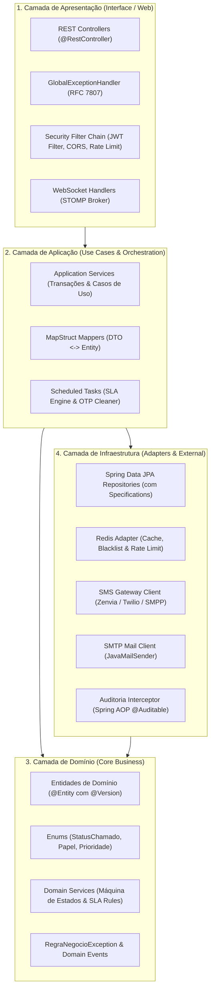
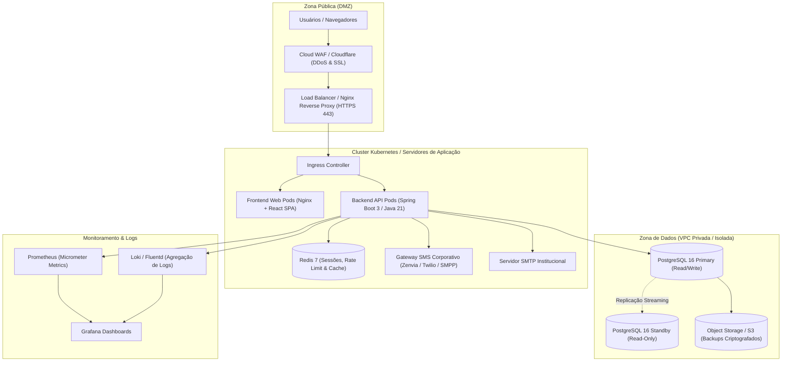

# Especificação Completa de Requisitos, Arquitetura de Pastas e Classes, Segurança, Tecnologias e Infraestrutura do Back-End Java (Spring Boot 3 / Java 21)

Este documento estabelece a especificação técnica oficial, análise detalhada de requisitos, **arquitetura completa de pastas, pacotes e catálogo detalhado de todas as classes Java**, **arquitetura de segurança em profundidade (Defense-in-Depth, Zero Trust, OWASP Top 10, Spring Security 6, JWT & RBAC)**, modelagem relacional, catálogo de contratos REST, **pilha de tecnologias, dependências Maven (`pom.xml`), configurações (`application.yml`), classes Java de segurança e infraestrutura (Docker, Kubernetes, CI/CD, Observabilidade)** para a **Central Institucional de Chamados (Ticket Hub)**.

---

## 1. Visão Geral e Arquitetura do Sistema

### 1.1 Objetivo
Substituir a camada simulada (`mock-api.ts`) por uma API RESTful corporativa, resiliente, segura e auditável desenvolvida em **Java 21 LTS** e **Spring Boot 3.3+**, mantendo **100% de compatibilidade** com o front-end React/TypeScript já existente.

### 1.2 Padrão Arquitetural de Software (Clean Layered Architecture)

A aplicação adota uma **Arquitetura Limpa em Camadas (Layered Clean Architecture)** com princípios de **Domain-Driven Design (DDD)** pragmático, garantindo baixo acoplamento, testabilidade e separação rigorosa de responsabilidades:



---

## 2. Arquitetura Detalhada de Pastas, Pacotes e Classes

### 2.1 Árvore Completa de Diretórios do Projeto

```text
ticket-hub-api/
├── pom.xml                                      # Configuração de dependências Maven e plugins de build
├── mvnw / mvnw.cmd                              # Maven Wrapper
├── Dockerfile                                   # Build multi-stage para containerização (Java 21 JRE)
├── README.md                                    # Instruções de setup e desenvolvimento
│
├── src/
│   ├── main/
│   │   ├── java/
│   │   │   └── br/
│   │   │       └── gov/
│   │   │           └── tickethub/
│   │   │               ├── TicketHubApiApplication.java       # Ponto de entrada da aplicação Spring Boot
│   │   │               │
│   │   │               ├── config/                            # Classes de configuração de infraestrutura
│   │   │               │   ├── SecurityConfig.java            # Spring Security 6, RBAC e regras de rotas
│   │   │               │   ├── CorsConfig.java                # Política de CORS para o frontend React
│   │   │               │   ├── OpenApiConfig.java             # Especificação Swagger / OpenAPI com Bearer Auth
│   │   │               │   ├── RedisConfig.java               # Serializadores e conexão Lettuce com Redis
│   │   │               │   ├── WebSocketConfig.java           # Broker STOMP e endpoints de WebSocket
│   │   │               │   ├── JpaAuditingConfig.java         # Auditoria automática de entidades (@CreatedDate)
│   │   │               │   ├── AsyncConfig.java               # Configuração de execução assíncrona (Virtual Threads)
│   │   │               │   └── JacksonConfig.java             # Formatação de datas ISO-8601 e UTC
│   │   │               │
│   │   │               ├── domain/                            # Camada de Domínio / Regras de Negócio
│   │   │               │   ├── model/                         # Entidades JPA persistidas no PostgreSQL
│   │   │               │   │   ├── Usuario.java               # Servidores, perfis e credenciais
│   │   │               │   │   ├── UsuarioSetorLiberado.java  # Mapeamento de filas autorizadas por técnico
│   │   │               │   │   ├── Chamado.java               # Entidade central de chamado (com @Version)
│   │   │               │   │   ├── Comentario.java            # Mensagens públicas e notas técnicas internas
│   │   │               │   │   ├── HistoricoChamado.java      # Trilha de auditoria interna do chamado
│   │   │               │   │   ├── ChamadoVinculo.java        # Relacionamentos (duplicados / relacionados)
│   │   │               │   │   ├── Servico.java               # Itens do catálogo de serviços
│   │   │               │   │   ├── SlaConfig.java             # Prazos de atendimento/resolução por prioridade
│   │   │               │   │   ├── ConfigDominio.java         # Domínios institucionais permitidos e padrão
│   │   │               │   │   ├── Auditoria.java             # Trilha de auditoria global de operações
│   │   │               │   │   ├── Notificacao.java           # Alertas do sino de notificações do usuário
│   │   │               │   │   └── RecuperacaoSms.java        # OTPs de 6 dígitos e tickets temporários
│   │   │               │   │
│   │   │               │   └── enums/                         # Enumerações de Domínio
│   │   │               │       ├── Papel.java                 # USUARIO, TECNICO, ADMIN, SUPERUSUARIO
│   │   │               │       ├── StatusChamado.java         # AGUARDANDO, EM_ANDAMENTO, PAUSADO, RESOLVIDO, CANCELADO
│   │   │               │       ├── PrioridadeChamado.java     # BAIXA, MEDIA, ALTA, CRITICA
│   │   │               │       ├── TipoHistorico.java         # ABERTURA, ASSUNCAO, STATUS, ENCAMINHAMENTO, etc.
│   │   │               │       └── TipoVinculo.java           # RELACIONADO, DUPLICADO
│   │   │               │
│   │   │               ├── dto/                               # Data Transfer Objects (Records imutáveis)
│   │   │               │   ├── request/                       # DTOs de Entrada (Payloads validados)
│   │   │               │   │   ├── LoginRequest.java
│   │   │               │   │   ├── RefreshTokenRequest.java
│   │   │               │   │   ├── CompletarCadastroRequest.java
│   │   │               │   │   ├── AlterarSenhaRequest.java
│   │   │               │   │   ├── SolicitarSmsRequest.java
│   │   │               │   │   ├── ValidarSmsRequest.java
│   │   │               │   │   ├── RedefinirSenhaRequest.java
│   │   │               │   │   ├── NovoChamadoRequest.java
│   │   │               │   │   ├── AtualizarChamadoRequest.java
│   │   │               │   │   ├── EncaminharChamadoRequest.java
│   │   │               │   │   ├── DevolverChamadoRequest.java
│   │   │               │   │   ├── ReabrirChamadoRequest.java
│   │   │               │   │   ├── AvaliarChamadoRequest.java
│   │   │               │   │   ├── NovoComentarioRequest.java
│   │   │               │   │   ├── VincularChamadoRequest.java
│   │   │               │   │   ├── CriarUsuarioRequest.java
│   │   │               │   │   ├── AtualizarUsuarioRequest.java
│   │   │               │   │   ├── ResetarSenhaManualRequest.java
│   │   │               │   │   ├── ImportarUsuariosLoteRequest.java
│   │   │               │   │   ├── UsuarioLoteItemDTO.java
│   │   │               │   │   ├── ConfigDominiosRequest.java
│   │   │               │   │   ├── ServicoRequest.java
│   │   │               │   │   └── SlaConfigRequest.java
│   │   │               │   │
│   │   │               │   └── response/                      # DTOs de Saída (Respostas da API)
│   │   │               │       ├── ApiResponse.java           # Envelope padronizado { data, mensagem, erros }
│   │   │               │       ├── AuthResponse.java          # Retorno com JWT, Refresh Token e dados do usuário
│   │   │               │       ├── UsuarioResponse.java       # Dados cadastrais do servidor
│   │   │               │       ├── ChamadoResumoResponse.java # Visão enxuta para tabelas de fila
│   │   │               │       ├── ChamadoDetalheResponse.java# Visão completa com histórico e comentários
│   │   │               │       ├── ComentarioResponse.java    # Dados do comentário com autor
│   │   │               │       ├── HistoricoResponse.java     # Eventos do histórico
│   │   │               │       ├── ServicoResponse.java       # Serviço do catálogo
│   │   │               │       ├── SlaConfigResponse.java     # Tabela de SLA
│   │   │               │       ├── ConfigDominiosResponse.java# Domínios e padrão pré-selecionado
│   │   │               │       ├── AuditoriaResponse.java     # Registro de auditoria
│   │   │               │       ├── NotificacaoResponse.java   # Notificação individual
│   │   │               │       ├── NotificacoesListResponse.java# Lista de notificações + contador não lidas
│   │   │               │       ├── MetricasResponse.java      # Indicadores executivos e cumprimento de SLA
│   │   │               │       ├── ImportarLoteResponse.java  # Relatório de importação (sucessos e rejeições)
│   │   │               │       └── PaginacaoResponse.java     # Container paginado { items, total, page, totalPages }
│   │   │               │
│   │   │               ├── repository/                        # Camada de Persistência (Spring Data JPA)
│   │   │               │   ├── UsuarioRepository.java
│   │   │               │   ├── ChamadoRepository.java
│   │   │               │   ├── ComentarioRepository.java
│   │   │               │   ├── HistoricoChamadoRepository.java
│   │   │               │   ├── ServicoRepository.java
│   │   │               │   ├── SlaConfigRepository.java
│   │   │               │   ├── ConfigDominioRepository.java
│   │   │               │   ├── AuditoriaRepository.java
│   │   │               │   ├── NotificacaoRepository.java
│   │   │               │   ├── RecuperacaoSmsRepository.java
│   │   │               │   └── specification/                 # Filtros Dinâmicos com JPA Criteria
│   │   │               │       ├── ChamadoSpecification.java  # Filtros por setor, status, solicitante, fila, q
│   │   │               │       └── AuditoriaSpecification.java# Filtros por período, usuário e ação
│   │   │               │
│   │   │               ├── service/                           # Camada de Serviços e Regras de Negócio
│   │   │               │   ├── AuthService.java               # Interface de autenticação, refresh e OTP
│   │   │               │   ├── UsuarioService.java            # Interface de gestão de usuários e lotes
│   │   │               │   ├── ChamadoService.java            # Interface do ciclo de vida dos chamados
│   │   │               │   ├── SlaService.java                # Interface de cálculo e controle de SLA
│   │   │               │   ├── ServicoService.java            # Interface de catálogo de serviços
│   │   │               │   ├── AuditoriaService.java          # Interface de gravação e consulta de auditoria
│   │   │               │   ├── NotificacaoService.java        # Interface de notificações e WebSocket push
│   │   │               │   ├── SmsService.java                # Interface de envio de SMS corporativo
│   │   │               │   ├── EmailService.java              # Interface de envio de e-mails SMTP
│   │   │               │   └── impl/                          # Implementações (@Service @Transactional)
│   │   │               │       ├── AuthServiceImpl.java
│   │   │               │       ├── UsuarioServiceImpl.java
│   │   │               │       ├── ChamadoServiceImpl.java
│   │   │               │       ├── SlaServiceImpl.java
│   │   │               │       ├── ServicoServiceImpl.java
│   │   │               │       ├── AuditoriaServiceImpl.java
│   │   │               │       ├── NotificacaoServiceImpl.java
│   │   │               │       ├── SmsServiceImpl.java
│   │   │               │       └── EmailServiceImpl.java
│   │   │               │
│   │   │               ├── security/                          # Componentes de Segurança e Criptografia
│   │   │               │   ├── JwtService.java                # Geração, assinatura e validação de tokens JWT
│   │   │               │   ├── JwtAuthenticationFilter.java   # Filtro HTTP OncePerRequest para Bearer Token
│   │   │               │   ├── UserDetailsServiceImpl.java    # Integração do Spring Security com o banco de dados
│   │   │               │   ├── UserPrincipal.java             # Implementação customizada de UserDetails
│   │   │               │   ├── SecurityUtils.java             # Helper estático para obter o usuário logado
│   │   │               │   ├── ChamadoSecurity.java           # Avaliador SpEL para checar posse e filas liberadas
│   │   │               │   └── RateLimiterService.java        # Rate Limiting com Token Bucket no Redis
│   │   │               │
│   │   │               ├── controller/                        # Endpoints REST (@RestController)
│   │   │               │   ├── AuthController.java            # Login, Refresh, Onboarding, Reset SMS
│   │   │               │   ├── ChamadoController.java         # CRUD, Filas, Assunção, Devolução, Resolução
│   │   │               │   ├── UsuarioController.java         # Listagem, Cadastro, Lote, Reset Manual
│   │   │               │   ├── CatalogoController.java        # Gestão de serviços do catálogo
│   │   │               │   ├── SlaController.java             # Parametrização de SLA por prioridade
│   │   │               │   ├── ConfiguracaoController.java    # Gestão de domínios institucionais
│   │   │               │   ├── AuditoriaController.java       # Trilha de auditoria (com isolamento por perfil)
│   │   │               │   ├── NotificacaoController.java     # Sino de notificações e marcação de lidas
│   │   │               │   └── RelatorioController.java       # Métricas operacionais e exportações
│   │   │               │
│   │   │               ├── mapper/                            # Mapeadores MapStruct (Entity <-> DTO)
│   │   │               │   ├── UsuarioMapper.java
│   │   │               │   ├── ChamadoMapper.java
│   │   │               │   ├── ComentarioMapper.java
│   │   │               │   ├── ServicoMapper.java
│   │   │               │   ├── AuditoriaMapper.java
│   │   │               │   └── NotificacaoMapper.java
│   │   │               │
│   │   │               ├── exception/                         # Tratamento Global de Erros e Exceções
│   │   │               │   ├── GlobalExceptionHandler.java    # @RestControllerAdvice com RFC 7807
│   │   │               │   ├── BusinessException.java         # Exceção genérica de regra de negócio (422)
│   │   │               │   ├── ResourceNotFoundException.java # Recurso não localizado (404)
│   │   │               │   ├── UnauthorizedException.java     # Falha de autenticação (401)
│   │   │               │   ├── ForbiddenException.java        # Falha de autorização / setor bloqueado (403)
│   │   │               │   ├── ConflictException.java         # Duplicidade de e-mail / protocolo (409)
│   │   │               │   └── ProblemDetailResponse.java     # Formato estruturado de erro
│   │   │               │
│   │   │               └── task/                              # Tarefas Agendadas em Background (@Scheduled)
│   │   │                   ├── SlaCalculationScheduler.java   # Monitoramento contínuo de estouro de SLA
│   │   │                   └── OtpCleanerScheduler.java       # Limpeza periódica de OTPs de SMS expirados
│   │   │
│   │   └── resources/
│   │       ├── application.yml                                # Configurações gerais da aplicação
│   │       ├── application-dev.yml                            # Perfil de desenvolvimento local
│   │       ├── application-prod.yml                           # Perfil de produção (Kubernetes / Docker)
│   │       └── db/
│   │           └── migration/                                 # Scripts de Migração Versionada Flyway
│   │               ├── V1__init_schema.sql                    # Criação das 12 tabelas e índices
│   │               ├── V2__seed_initial_data.sql              # Carga inicial do superusuário e catálogo
│   │               └── V3__triggers_audit.sql                 # Triggers automáticas de auditoria
│   │
│   └── test/
│       ├── java/
│       │   └── br/
│       │       └── gov/
│       │           └── tickethub/
│       │               ├── service/                           # Testes Unitários de Serviços (Mockito)
│       │               │   ├── ChamadoServiceTest.java
│       │               │   ├── SlaServiceTest.java
│       │               │   ├── UsuarioServiceTest.java
│       │               │   └── AuthServiceTest.java
│       │               ├── controller/                        # Testes de Integração de Controllers (MockMvc)
│       │               │   ├── ChamadoControllerIntegrationTest.java
│       │               │   ├── AuthControllerIntegrationTest.java
│       │               │   └── AuditoriaControllerIntegrationTest.java
│       │               └── testcontainers/                    # Testes com PostgreSQL e Redis Reais
│       │                   └── BaseIntegrationTest.java
│       └── resources/
│           └── application-test.yml                           # Configuração dos testes automatizados
```

---

### 2.2 Catálogo Detalhado de Responsabilidade de Cada Classe

#### 📦 Pacote `config/` (Configurações do Framework)
- **`SecurityConfig.java`**: Configura o `SecurityFilterChain` do Spring Security 6. Define rotas públicas vs. autenticadas, desabilita CSRF (por ser API REST stateless com JWT), configura o `DaoAuthenticationProvider`, o `BCryptPasswordEncoder(12)` e a política de CORS.
- **`CorsConfig.java`**: Configura as origens permitidas (`allowed-origins`), métodos HTTP (`GET, POST, PUT, DELETE, OPTIONS`) e liberação do envio de credenciais (cookies/tokens).
- **`OpenApiConfig.java`**: Configura o OpenAPI 3.0 para geração da documentação Swagger em `/swagger-ui.html`. Inclui a definição do esquema de segurança `bearerAuth` (JWT).
- **`RedisConfig.java`**: Cria o `RedisTemplate<String, Object>` com serializadores `StringRedisSerializer` para chaves e `GenericJackson2JsonRedisSerializer` para objetos JSON.
- **`WebSocketConfig.java`**: Implementa `WebSocketMessageBrokerConfigurer`, habilitando o broker `/topic` (broadcast) e `/queue` (mensagens privadas por usuário `/user`), além do endpoint de handshake `/ws`.
- **`JpaAuditingConfig.java`**: Habilita `@EnableJpaAuditing` para preenchimento automático de campos `@CreatedDate` e `@LastModifiedDate` nas entidades.
- **`AsyncConfig.java`**: Habilita `@EnableAsync` utilizando o pool de **Virtual Threads** do Java 21 (`Executors.newVirtualThreadPerTaskExecutor()`).

---

#### 📦 Pacote `domain/model/` (Entidades de Banco de Dados JPA)
- **`Usuario.java`**: Representa a tabela `tb_usuario`. Contém `id`, `nome`, `email`, `senhaHash`, `papel` (Enum `Papel`), `setor`, `telefone`, `localidade`, `podeCadastrarUsuarios`, `primeiroAcessoConcluido`, `ativo`, `criadoEm` e a coleção `@ElementCollection` de `setoresLiberados`.
- **`Chamado.java`**: Representa a tabela `tb_chamado`. Contém `id`, `protocolo`, `titulo`, `descricao`, `status` (Enum `StatusChamado`), `prioridade` (Enum `PrioridadeChamado`), `setor`, `servico` (`@ManyToOne`), `solicitante` (`@ManyToOne`), `tecnico` (`@ManyToOne`), `filaSetor`, `@Version Long versao` (concorrência otimista), `slaAtendimentoHoras`, `slaResolucaoHoras`, `slaConsumidoMs`, `slaRodandoDesde`, `primeiraRespostaEm`, `oQueFoiFeito`, `resolvidoEm`, `motivoReabertura`, `avaliacao` e coleções de comentários e histórico.
- **`Comentario.java`**: Representa `tb_comentario`. Relaciona `@ManyToOne` com `Chamado` e `Usuario` (autor), contendo a `mensagem`, flag `interno` (nota técnica invisível ao solicitante) e data de criação.
- **`HistoricoChamado.java`**: Representa `tb_historico_chamado`. Armazena imutavelmente cada mudança de status, assunção, encaminhamento ou devolução com `tipo`, `descricao` e `autorNome`.
- **`ChamadoVinculo.java`**: Representa `tb_chamado_vinculo`. Mapeia associações entre chamados (`chamadoOrigemId`, `chamadoDestinoId`, `tipo` Enum `TipoVinculo`).
- **`Servico.java`**: Representa `tb_servico`. Define itens do catálogo com `nome`, `setor`, `prioridade`, prazos de SLA e flag `ativo`.
- **`SlaConfig.java`**: Representa `tb_sla_config`. Tabela paramétrica com os prazos padrão em horas por prioridade (`baixa`, `media`, `alta`, `critica`).
- **`ConfigDominio.java`**: Representa `tb_config_dominio`. Lista os domínios aceitos pela instituição e define qual é o pré-selecionado (`ehPadrao`).
- **`Auditoria.java`**: Representa `tb_auditoria`. Registra todas as ações do sistema com `acao`, `detalhe`, `usuarioId`, `usuarioNome`, `ipOrigem` e `criadoEm`.
- **`Notificacao.java`**: Representa `tb_notificacao`. Alertas do usuário com `usuarioId`, `chamadoId`, `tipo`, `mensagem` e flag `lida`.
- **`RecuperacaoSms.java`**: Representa `tb_recuperacao_sms`. Armazena o `codigoHash` (OTP de 6 dígitos), `ticketValidacao`, `expiraEm`, contador de `tentativas` e flag `utilizado`.

---

#### 📦 Pacote `dto/` (Records de Entrada e Saída)
- **`LoginRequest.java`**: `record LoginRequest(@NotBlank @Email String email, @NotBlank @Size(min = 6) String password)`
- **`NovoChamadoRequest.java`**: `record NovoChamadoRequest(@NotBlank @Size(min = 5, max = 200) String titulo, @NotBlank String descricao, @NotBlank String servicoId)`
- **`AtualizarChamadoRequest.java`**: `record AtualizarChamadoRequest(StatusChamado status, PrioridadeChamado prioridade, String oQueFoiFeito, Long versao)`
- **`DevolverChamadoRequest.java`**: `record DevolverChamadoRequest(@NotBlank @Size(min = 3) String motivo)`
- **`EncaminharChamadoRequest.java`**: `record EncaminharChamadoRequest(String tecnicoId, String filaSetor, @NotBlank String motivo)`
- **`ImportarUsuariosLoteRequest.java`**: `record ImportarUsuariosLoteRequest(@NotEmpty List<UsuarioLoteItemDTO> usuarios)`
- **`ApiResponse.java`**: `record ApiResponse<T>(T data, String mensagem, List<String> erros, int status)`
- **`PaginacaoResponse.java`**: `record PaginacaoResponse<T>(List<T> items, long total, int page, int limit, int totalPages)`

---

#### 📦 Pacote `repository/` (Acesso a Dados)
- **`UsuarioRepository.java`**: Métodos `findByEmail(String email)`, `existsByEmail(String email)`, `findByPapel(Papel papel)`.
- **`ChamadoRepository.java`**: Estende `JpaRepository<Chamado, String>` e `JpaSpecificationExecutor<Chamado>` para consultas paginadas com filtros dinâmicos complexos.
- **`ChamadoSpecification.java`**: Constrói predicados dinâmicos JPA Criteria combinando:
  - Filtro de visibilidade por perfil (`solicitante.id == user.id` para usuário comum; `setor IN (setoresLiberados)` para técnicos e administradores).
  - Filtros de query parameters: `status`, `prioridade`, `setor`, `servicoId`, `fila` (`minha` onde `tecnico.id == user.id`; `geral` onde `tecnico IS NULL`), busca textual `q` por protocolo, título ou solicitante.
- **`AuditoriaRepository.java` & `AuditoriaSpecification.java`**: Permite filtrar logs de auditoria com isolamento rigoroso (`usuarioId == user.id` quando o solicitante for perfil `tecnico`).

---

#### 📦 Pacote `service/` (Casos de Uso e Lógica de Negócio)
- **`AuthServiceImpl.java`**:
  - `login()`: Autentica credenciais com `AuthenticationManager`, emite JWT e Refresh Token, grava auditoria `auth.login`.
  - `refreshToken()`: Valida o refresh token no Redis e emite novo par de tokens.
  - `solicitarCodigoSms()`: Localiza o usuário, gera OTP numérico aleatório de 6 dígitos, salva hash no banco/Redis com expiração de 5 minutos e dispara SMS corporativo.
  - `validarCodigoSms()`: Valida OTP com controle de rate limiting (máximo 3 tentativas) e gera ticket temporário UUID de redefinição.
  - `redefinirSenhaComTicket()`: Aplica a nova senha criptografada com BCrypt e invalida o ticket.
  - `completarCadastro()`: Salva telefone e localidade física no primeiro login e marca `primeiroAcessoConcluido = true`.
- **`ChamadoServiceImpl.java`**:
  - `criarChamado()`: Gera protocolo único (ex.: `CH-2026-0825-XXXX`), calcula prazos de SLA a partir do catálogo, persiste e notifica o setor via WebSocket.
  - `assumirChamado()`: Atribui o técnico logado ao chamado, finaliza o SLA de primeiro atendimento (`primeiraRespostaEm`), sincroniza SLA de resolução e grava histórico.
  - `pausarChamado()` & `retomarChamado()`: Congela/retoma a contagem de SLA atualizando `slaConsumidoMs` e `slaRodandoDesde`.
  - `resolverChamado()`: Valida o preenchimento obrigatório de `oQueFoiFeito`, altera status para `resolvido`, grava data de resolução e notifica o solicitante para avaliação.
  - `devolverChamado()`: Remove técnico atribuído, retorna chamado para `filaSetor` com justificativa e reativa contagem de SLA.
  - `reabrirChamado()`: Ação exclusiva de administradores/superusuários para reabrir chamado resolvido.
- **`UsuarioServiceImpl.java`**:
  - `criarUsuario()`: Valida se o domínio pertence a `tb_config_dominio`, criptografa senha temporária e persiste.
  - `importarEmLote()`: Processa lista em lote, valida linha a linha integridade, duplicatas e domínios, persistindo em lote e retornando relatório com lista de sucessos e falhas.
  - `resetarSenhaManual()`: Permite que Admin/Super/Técnico gere nova senha aleatória para servidores com auditoria registrada.

---

#### 📦 Pacote `security/` (Componentes de Segurança)
- **`JwtService.java`**: Métodos `generateToken()`, `generateRefreshToken()`, `extractUsername()`, `extractClaim()`, `isTokenValid()`. Utiliza a biblioteca `io.jsonwebtoken` (JJWT 0.12.5).
- **`JwtAuthenticationFilter.java`**: Intercepta toda requisição HTTP, extrai o header `Authorization: Bearer <token>`, checa se o token está na lista negra do Redis, valida a assinatura e injeta o `UsernamePasswordAuthenticationToken` no `SecurityContextHolder`.
- **`ChamadoSecurity.java`**: Bean `@Component("chamadoSecurity")` utilizado em anotações SpEL para validar em tempo de execução se o técnico possui permissão para atuar sobre o setor do chamado.
- **`RateLimiterService.java`**: Implementa o algoritmo de Token Bucket utilizando comandos atômicos do Redis (`INCR` e `EXPIRE`) para mitigar ataques de força bruta.

---

#### 📦 Pacote `exception/` (Tratamento Global de Erros)
- **`GlobalExceptionHandler.java`**: Anotado com `@RestControllerAdvice`. Captura todas as exceções da aplicação e formata respostas no padrão **RFC 7807 Problem Details**:
  - `MethodArgumentNotValidException` $\rightarrow$ `400 Bad Request` com lista detalhada de campos inválidos.
  - `ResourceNotFoundException` $\rightarrow$ `404 Not Found`.
  - `ForbiddenException` / `AccessDeniedException` $\rightarrow$ `403 Forbidden`.
  - `ConflictException` $\rightarrow$ `409 Conflict`.
  - `OptimisticLockException` $\rightarrow$ `409 Conflict` (informando que o registro foi modificado por outro operador).
  - `Exception` genérica $\rightarrow$ `500 Internal Server Error` (mascarando detalhes internos em produção).

---

## 3. Arquitetura de Segurança em Profundidade (Defense-in-Depth & Zero Trust)

```mermaid
graph LR
    Req["Requisição HTTPS"] --> WAF["WAF & Rate Limiter (IP)"]
    WAF --> Headers["Secure Headers (CSP, HSTS, X-Frame)"]
    Headers --> CorsFilter["CORS Validation Filter"]
    CorsFilter --> JwtAuth["JwtAuthenticationFilter (Bearer Validation)"]
    JwtAuth --> Blacklist["Redis Token Blacklist Check"]
    Blacklist --> MethodSec["@PreAuthorize / SpEL (RBAC & Setores)"]
    MethodSec --> Sanitizer["OWASP HTML Sanitizer (XSS Protection)"]
    Sanitizer --> ServiceLogic["Lógica de Negócio Segura"]
    ServiceLogic --> AuditLog["Trilha de Auditoria Imutável"]
```



### 3.1 Proteção Ativa Contra as Vulnerabilidades OWASP Top 10

| Vulnerabilidade OWASP | Mitigação Implementada no Back-End Java |
| :--- | :--- |
| **A01: Broken Access Control** | Verificação de permissões em 2 camadas (`SecurityFilterChain` + `@PreAuthorize` com checagem de `setoresLiberados` no banco/JWT). Usuários comuns nunca acessam dados de outros solicitantes. |
| **A02: Cryptographic Failures** | Senhas hasheadas com `BCryptPasswordEncoder` (fator de custo 12). Tokens e códigos SMS armazenados como hash SHA-256 no banco e Redis. Conexões SSL/TLS 1.3 obrigatórias em trânsito. |
| **A03: Injection (SQL & NoSQL)** | Utilização estrita de Spring Data JPA / Hibernate com **Prepared Statements** parametrizados. Não há concatenação de queries SQL nativas. |
| **A03: Cross-Site Scripting (XSS)** | Sanitização de todos os campos de texto livre (descrições, comentários, justificativas) via `OWASP Java HTML Sanitizer` antes da persistência no PostgreSQL. |
| **A04: Insecure Design & Brute Force** | **Rate Limiting** com algoritmo Token Bucket via Redis (máximo 5 tentativas de login por minuto por IP; máximo 3 tentativas de código SMS por telefone/usuário antes do bloqueio temporário). |
| **A05: Security Misconfiguration** | Headers de segurança HTTP ativados no `SecurityConfig`: `X-Content-Type-Options: nosniff`, `X-Frame-Options: DENY`, `Content-Security-Policy`, `Strict-Transport-Security: max-age=31536000; includeSubDomains`. |
| **A07: Identification Failures** | Recuperação de senha por SMS OTP com código numérico criptográfico de 6 dígitos, expiração estrita de 5 minutos e descarte imediato após o primeiro uso. |
| **A08: Software & Data Integrity** | Validação estrita de DTOs com Jakarta Bean Validation (`@Valid`, `@NotNull`, `@Size`, `@Pattern`). Concorrência otimista com `@Version` contra sobreescrita acidental de dados (*lost updates*). |
| **A09: Security Logging & Monitoring** | Trilha de auditoria centralizada (`tb_auditoria`) gravando IP de origem, User-Agent, data/hora, autor e evento para todas as mutações cadastrais e de atendimento. |
| **A10: Server-Side Request Forgery (SSRF)**| URLs externas de Gateway SMS e Webhooks validadas contra lista estrita de domínios confiáveis (*whitelist*). |

---

## 4. Configurações Prontas para Produção (`pom.xml` e `application.yml`)

### 4.1 `pom.xml` Oficial

```xml
<?xml version="1.0" encoding="UTF-8"?>
<project xmlns="http://maven.apache.org/POM/4.0.0"
         xmlns:xsi="http://www.w3.org/2001/XMLSchema-instance"
         xsi:schemaLocation="http://maven.apache.org/POM/4.0.0 https://maven.apache.org/xsd/maven-4.0.0.xsd">
    <modelVersion>4.0.0</modelVersion>
    <parent>
        <groupId>org.springframework.boot</groupId>
        <artifactId>spring-boot-starter-parent</artifactId>
        <version>3.3.2</version>
        <relativePath/>
    </parent>
    
    <groupId>br.gov.instituto</groupId>
    <artifactId>ticket-hub-api</artifactId>
    <version>1.0.0</version>
    <name>ticket-hub-api</name>
    <description>API Corporativa da Central Institucional de Chamados</description>
    
    <properties>
        <java.version>21</java.version>
        <jjwt.version>0.12.5</jjwt.version>
        <org.mapstruct.version>1.5.5.Final</org.mapstruct.version>
        <springdoc.version>2.5.0</springdoc.version>
        <testcontainers.version>1.19.8</testcontainers.version>
    </properties>
    
    <dependencies>
        <!-- Web & Validation -->
        <dependency>
            <groupId>org.springframework.boot</groupId>
            <artifactId>spring-boot-starter-web</artifactId>
        </dependency>
        <dependency>
            <groupId>org.springframework.boot</groupId>
            <artifactId>spring-boot-starter-validation</artifactId>
        </dependency>
        
        <!-- Segurança & JWT -->
        <dependency>
            <groupId>org.springframework.boot</groupId>
            <artifactId>spring-boot-starter-security</artifactId>
        </dependency>
        <dependency>
            <groupId>io.jsonwebtoken</groupId>
            <artifactId>jjwt-api</artifactId>
            <version>${jjwt.version}</version>
        </dependency>
        <dependency>
            <groupId>io.jsonwebtoken</groupId>
            <artifactId>jjwt-impl</artifactId>
            <version>${jjwt.version}</version>
            <scope>runtime</scope>
        </dependency>
        <dependency>
            <groupId>io.jsonwebtoken</groupId>
            <artifactId>jjwt-jackson</artifactId>
            <version>${jjwt.version}</version>
            <scope>runtime</scope>
        </dependency>
        
        <!-- Banco de Dados, JPA & Flyway -->
        <dependency>
            <groupId>org.springframework.boot</groupId>
            <artifactId>spring-boot-starter-data-jpa</artifactId>
        </dependency>
        <dependency>
            <groupId>org.postgresql</groupId>
            <artifactId>postgresql</artifactId>
            <scope>runtime</scope>
        </dependency>
        <dependency>
            <groupId>org.flywaydb</groupId>
            <artifactId>flyway-core</artifactId>
        </dependency>
        <dependency>
            <groupId>org.flywaydb</groupId>
            <artifactId>flyway-database-postgresql</artifactId>
        </dependency>
        
        <!-- Redis, Cache & WebSocket -->
        <dependency>
            <groupId>org.springframework.boot</groupId>
            <artifactId>spring-boot-starter-data-redis</artifactId>
        </dependency>
        <dependency>
            <groupId>org.apache.commons</groupId>
            <artifactId>commons-pool2</artifactId>
        </dependency>
        <dependency>
            <groupId>org.springframework.boot</groupId>
            <artifactId>spring-boot-starter-websocket</artifactId>
        </dependency>
        <dependency>
            <groupId>org.springframework.boot</groupId>
            <artifactId>spring-boot-starter-mail</artifactId>
        </dependency>
        
        <!-- Swagger OpenAPI & Observabilidade -->
        <dependency>
            <groupId>org.springdoc</groupId>
            <artifactId>springdoc-openapi-starter-webmvc-ui</artifactId>
            <version>${springdoc.version}</version>
        </dependency>
        <dependency>
            <groupId>org.springframework.boot</groupId>
            <artifactId>spring-boot-starter-actuator</artifactId>
        </dependency>
        <dependency>
            <groupId>io.micrometer</groupId>
            <artifactId>micrometer-registry-prometheus</artifactId>
        </dependency>
        
        <!-- Utilitários -->
        <dependency>
            <groupId>org.projectlombok</groupId>
            <artifactId>lombok</artifactId>
            <optional>true</optional>
        </dependency>
        <dependency>
            <groupId>org.mapstruct</groupId>
            <artifactId>mapstruct</artifactId>
            <version>${org.mapstruct.version}</version>
        </dependency>
        
        <!-- Testes & Testcontainers -->
        <dependency>
            <groupId>org.springframework.boot</groupId>
            <artifactId>spring-boot-starter-test</artifactId>
            <scope>test</scope>
        </dependency>
        <dependency>
            <groupId>org.springframework.security</groupId>
            <artifactId>spring-security-test</artifactId>
            <scope>test</scope>
        </dependency>
        <dependency>
            <groupId>org.testcontainers</groupId>
            <artifactId>junit-jupiter</artifactId>
            <scope>test</scope>
        </dependency>
        <dependency>
            <groupId>org.testcontainers</groupId>
            <artifactId>postgresql</artifactId>
            <scope>test</scope>
        </dependency>
    </dependencies>
    
    <build>
        <plugins>
            <plugin>
                <groupId>org.apache.maven.plugins</groupId>
                <artifactId>maven-compiler-plugin</artifactId>
                <configuration>
                    <source>21</source>
                    <target>21</target>
                    <annotationProcessorPaths>
                        <path>
                            <groupId>org.projectlombok</groupId>
                            <artifactId>lombok</artifactId>
                            <version>${lombok.version}</version>
                        </path>
                        <path>
                            <groupId>org.mapstruct</groupId>
                            <artifactId>mapstruct-processor</artifactId>
                            <version>${org.mapstruct.version}</version>
                        </path>
                    </annotationProcessorPaths>
                </configuration>
            </plugin>
            <plugin>
                <groupId>org.springframework.boot</groupId>
                <artifactId>spring-boot-maven-plugin</artifactId>
            </plugin>
        </plugins>
    </build>
</project>
```

---

### 4.2 `application.yml` Oficial

```yaml
server:
  port: 8080
  servlet:
    context-path: /
  compression:
    enabled: true
    mime-types: text/html,text/xml,text/plain,text/css,text/javascript,application/javascript,application/json
    min-response-size: 1024

spring:
  application:
    name: ticket-hub-api
  threads:
    virtual:
      enabled: true
      
  datasource:
    url: ${SPRING_DATASOURCE_URL:jdbc:postgresql://localhost:5432/tickethub_db}
    username: ${SPRING_DATASOURCE_USERNAME:tickethub_user}
    password: ${SPRING_DATASOURCE_PASSWORD:SecretDbPassword123!}
    driver-class-name: org.postgresql.Driver
    hikari:
      pool-name: TicketHubHikariPool
      maximum-pool-size: 20
      minimum-idle: 5
      idle-timeout: 300000
      max-lifetime: 1200000
      connection-timeout: 20000
      leak-detection-threshold: 60000
      
  jpa:
    open-in-view: false
    hibernate:
      ddl-auto: validate
    properties:
      hibernate:
        dialect: org.hibernate.dialect.PostgreSQLDialect
        format_sql: false
        jdbc:
          batch_size: 50
          order_inserts: true
          order_updates: true
          
  flyway:
    enabled: true
    locations: classpath:db/migration
    baseline-on-migrate: true
    baseline-version: 0
    validate-on-migrate: true

  data:
    redis:
      host: ${SPRING_DATA_REDIS_HOST:localhost}
      port: ${SPRING_DATA_REDIS_PORT:6379}
      password: ${SPRING_DATA_REDIS_PASSWORD:SecretRedisPass123!}
      timeout: 2000ms
      lettuce:
        pool:
          max-active: 16
          max-idle: 8
          min-idle: 2
          max-wait: 2000ms

app:
  jwt:
    secret: ${JWT_SECRET:chave-super-secreta-institucional-minimo-256-bits-ticket-hub-sistema-2026}
    expiration-ms: 3600000
    refresh-expiration-ms: 604800000
  sms:
    gateway-url: ${SMS_GATEWAY_URL:https://api.zenvia.com/v2/channels/sms/messages}
    api-token: ${SMS_API_TOKEN:chave-sms-institucional}
    remetente: "TicketHub"
    otp-expiration-minutes: 5
    max-tentativas: 3
  cors:
    allowed-origins: ${CORS_ALLOWED_ORIGINS:http://localhost:8080,http://localhost:5173,https://chamados.instituto.gov.br}

springdoc:
  api-docs:
    path: /v3/api-docs
  swagger-ui:
    path: /swagger-ui.html
    operations-sorter: method
    tags-sorter: alpha
    display-request-duration: true

management:
  endpoints:
    web:
      exposure:
        include: health,info,prometheus,metrics
  endpoint:
    health:
      show-details: when_authorized
      probes:
        enabled: true
```

---

## 5. Mapeamento Completo de Endpoints REST (32 Endpoints)

| Método | Endpoint | Perfil Autorizado | Finalidade |
| :--- | :--- | :--- | :--- |
| **POST** | `/api/auth/login` | Público | Autenticação institucional com retorno de JWT e Refresh Token. |
| **POST** | `/api/auth/refresh` | Público | Renovação do Access Token a partir do Refresh Token. |
| **POST** | `/api/auth/completar-cadastro` | Autenticado | Atualiza telefone e localidade no primeiro acesso. |
| **POST** | `/api/auth/alterar-senha` | Autenticado | Altera a senha do próprio usuário autenticado. |
| **POST** | `/api/auth/recuperar-senha/solicitar-codigo` | Público | Dispara SMS com OTP de 6 dígitos para o telefone do servidor. |
| **POST** | `/api/auth/recuperar-senha/validar-codigo` | Público | Valida OTP recebido via SMS e devolve ticket de redefinição. |
| **POST** | `/api/auth/recuperar-senha/redefinir` | Público | Redefine senha com o ticket validado. |
| **GET** | `/api/chamados` | Autenticado | Lista paginada de chamados com filtros (`fila`, `status`, `prioridade`, `setor`, `q`). |
| **GET** | `/api/chamados/{id}` | Autenticado | Consulta detalhada do chamado com histórico, comentários e anexos. |
| **POST** | `/api/chamados` | `usuario`, `tecnico`, `admin`, `super` | Criação de novo chamado. |
| **PUT** | `/api/chamados/{id}` | `tecnico`, `admin`, `super` | Atualização de status, prioridade ou solução técnica com controle de concorrência (`versao`). |
| **POST** | `/api/chamados/{id}/assumir` | `tecnico`, `admin`, `super` | Técnico assume a responsabilidade do atendimento. |
| **POST** | `/api/chamados/{id}/devolver` | `tecnico`, `admin`, `super` | Devolve chamado com justificativa para a fila geral do setor. |
| **POST** | `/api/chamados/{id}/encaminhar` | `tecnico`, `admin`, `super` | Transfere chamado para outro técnico ou setor. |
| **POST** | `/api/chamados/{id}/reabrir` | `admin`, `super` | Reabre chamado resolvido mediante justificativa. |
| **POST** | `/api/chamados/{id}/avaliacao` | `solicitante` | Avaliação com nota de 1 a 5 após a resolução. |
| **POST** | `/api/chamados/{id}/comentarios`| Autenticado | Adiciona comentário público ou nota técnica interna. |
| **POST** | `/api/chamados/{id}/vinculos` | `tecnico`, `admin`, `super` | Vincula como chamado relacionado ou duplicado. |
| **GET** | `/api/chamados/metricas` | `admin`, `super`, `tecnico` | Métricas operacionais, tempo médio e cumprimento de SLA. |
| **GET** | `/api/usuarios` | `admin`, `super`, `tecnico` *(se permitido)* | Listagem paginada de servidores. |
| **POST** | `/api/usuarios` | `admin`, `super`, `tecnico` *(se permitido)* | Cadastro individual de servidor com validação de domínio. |
| **POST** | `/api/usuarios/lote` | `admin`, `super` | Importação em massa de usuários (CSV / Texto). |
| **PUT** | `/api/usuarios/{id}` | `admin`, `super` | Atualização de dados cadastrais, perfil e filas liberadas. |
| **POST** | `/api/usuarios/{id}/resetar-senha` | `tecnico`, `admin`, `super` | Reset manual de senha com geração de credencial temporária. |
| **GET** | `/api/configuracoes/dominios` | `admin`, `super` | Lista domínios institucionais aceitos e domínio padrão. |
| **POST** | `/api/configuracoes/dominios` | `super` | Adiciona, remove ou altera o domínio institucional padrão. |
| **GET** | `/api/servicos` | Autenticado | Catálogo de serviços ativos e prazos de SLA. |
| **POST** | `/api/servicos` | `super` | Adiciona novo serviço ao catálogo institucional. |
| **PUT** | `/api/servicos/{id}` | `super` | Edita serviço existente no catálogo. |
| **GET** | `/api/sla` | `admin`, `super` | Consulta tabela de SLAs por prioridade. |
| **PUT** | `/api/sla` | `super` | Parametriza prazos de atendimento e resolução por prioridade. |
| **GET** | `/api/auditoria` | `tecnico` *(próprios)*, `admin`, `super` *(todos)* | Consulta trilha de auditoria rastreável. |
| **GET** | `/api/notificacoes` | Autenticado | Lista notificações não lidas e recentes do usuário. |
| **POST** | `/api/notificacoes/ler` | Autenticado | Marca notificações como lidas. |

---

## 6. Arquitetura de Infraestrutura Completa (Docker, K8s, CI/CD & Observabilidade)

### 6.1 Topologia de Ambientes



---

### 6.2 Dockerfiles de Produção

#### Dockerfile do Back-End Java (Multi-stage Build com Eclipse Temurin 21)
```dockerfile
# Estágio 1: Build da Aplicação
FROM maven:3.9.6-eclipse-temurin-21-alpine AS builder
WORKDIR /app
COPY pom.xml .
RUN mvn dependency:go-offline -B
COPY src ./src
RUN mvn clean package -DskipTests -B

# Estágio 2: Imagem de Execução Mínima e Segura
FROM eclipse-temurin:21-jre-alpine AS runner
WORKDIR /app

RUN addgroup -S appgroup && adduser -S appuser -G appgroup
USER appuser

COPY --from=builder /app/target/*.jar app.jar

ENV JAVA_OPTS="-XX:+UseG1GC -XX:MaxRAMPercentage=75.0 -Duser.timezone=America/Sao_Paulo"
ENV SPRING_PROFILES_ACTIVE=prod

EXPOSE 8080
ENTRYPOINT ["sh", "-c", "java $JAVA_OPTS -jar app.jar"]
```

#### Dockerfile do Front-End React (Build Vite + Nginx Alpine)
```dockerfile
# Estágio 1: Build estático
FROM node:22-alpine AS build
WORKDIR /app
COPY package*.json ./
RUN npm ci
COPY . .
RUN npm run build

# Estágio 2: Servidor Nginx de Alta Performance
FROM nginx:alpine
COPY --from=build /app/dist /usr/share/nginx/html
COPY nginx.conf /etc/nginx/conf.d/default.conf
EXPOSE 80
CMD ["nginx", "-g", "daemon off;"]
```

---

### 6.3 Orquestração com Docker Compose (`docker-compose.yml`)

```yaml
version: '3.8'

services:
  postgres:
    image: postgres:16-alpine
    container_name: tickethub-postgres
    restart: unless-stopped
    environment:
      POSTGRES_DB: tickethub_db
      POSTGRES_USER: tickethub_user
      POSTGRES_PASSWORD: SecretDbPassword123!
    ports:
      - "5432:5432"
    volumes:
      - postgres_data:/var/lib/postgresql/data
    networks:
      - tickethub-net
    healthcheck:
      test: ["CMD-SHELL", "pg_isready -U tickethub_user -d tickethub_db"]
      interval: 5s
      timeout: 5s
      retries: 5

  redis:
    image: redis:7-alpine
    container_name: tickethub-redis
    restart: unless-stopped
    command: redis-server --requirepass SecretRedisPass123!
    ports:
      - "6379:6379"
    volumes:
      - redis_data:/data
    networks:
      - tickethub-net

  backend:
    build:
      context: ./backend
      dockerfile: Dockerfile
    container_name: tickethub-backend
    restart: unless-stopped
    depends_on:
      postgres:
        condition: service_healthy
      redis:
        condition: service_started
    environment:
      SPRING_PROFILES_ACTIVE: prod
      SPRING_DATASOURCE_URL: jdbc:postgresql://postgres:5432/tickethub_db
      SPRING_DATASOURCE_USERNAME: tickethub_user
      SPRING_DATASOURCE_PASSWORD: SecretDbPassword123!
      SPRING_DATA_REDIS_HOST: redis
      SPRING_DATA_REDIS_PORT: 6379
      SPRING_DATA_REDIS_PASSWORD: SecretRedisPass123!
      JWT_SECRET: chave-super-secreta-institucional-minimo-256-bits-ticket-hub-sistema-2026
      JWT_EXPIRATION_MS: 3600000
    ports:
      - "8080:8080"
    networks:
      - tickethub-net

  frontend:
    build:
      context: ./frontend
      dockerfile: Dockerfile
    container_name: tickethub-frontend
    restart: unless-stopped
    depends_on:
      - backend
    ports:
      - "80:80"
    networks:
      - tickethub-net

volumes:
  postgres_data:
  redis_data:

networks:
  tickethub-net:
    driver: bridge
```

---

## 7. Decisão de Arquitetura de Repositório: Backend Separado vs. No Mesmo Repositório

### 7.1 Comparativo Técnico

| Critério | Repositórios Separados (Multi-repo) | Monorepo Estruturado (`/backend` e `/frontend`) | Backend embutido na pasta do Front |
| :--- | :--- | :--- | :--- |
| **Adequação Institucional** | ⭐⭐⭐⭐⭐ **Altamente Recomendado** | ⭐⭐⭐⭐ Muito Bom | ❌ **Anti-pattern / Inviável** |
| **Pipelines de CI/CD** | Isoladas e ultrarrápidas | Exige regras de *path filter* | Conflituoso e lento |
| **Controle de Acessos** | Permissões granulares por time | Acesso total ao código | Sem separação de papéis |
| **Gerenciamento de Build** | Maven puro e Node puro | Raiz com orquestrador | `package.json` misturado com `pom.xml` |
| **Deploy e Versionamento**| Deploys desacoplados (Semantic Versioning) | Tags conjuntas | Bloqueio mútuo em releases |

### 7.2 Recomendação Prática

1. **Recomendação Principal (Padrão Corporativo/Governamental)**:
   - **Dois repositórios Git independentes**:
     - `ticket-hub-frontend` (React + Vite + TypeScript + Tailwind)
     - `ticket-hub-backend` (Java 21 + Spring Boot 3 + Maven)
   - **Vantagem**: A equipe de front-end pode lançar melhorias de interface e correções visuais sem disparar a esteira do backend Java, e o backend pode aplicar patches de banco e segurança de forma independente.

2. **Alternativa Válida (Monorepo Organizado)**:
   - Se for mantido no mesmo repositório do Git, deve-se criar **pastas irmãs de primeiro nível**:
     ```text
     ticket-hub-sistema/
     ├── frontend/          # Todo o código React, Vite, package.json
     ├── backend/           # Todo o código Java, Spring Boot, pom.xml
     ├── docs/              # Especificações e PDFs de arquitetura
     ├── docker-compose.yml # Orquestração local de todos os serviços
     └── README.md
     ```
   - ⚠️ **Importante**: **Nunca crie o código Java dentro das pastas do React (`src/` do front)**, pois isso mistura os ecossistemas, quebra ferramentas de análise estática e expõe arquivos de configuração do servidor.
